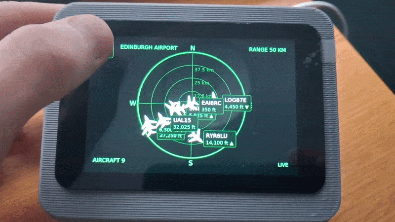
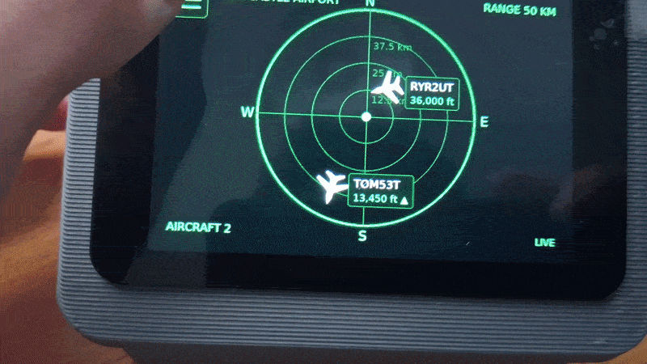

# Flight Radar:

This project was inspired by a number of projects I had seen previously online showing a flight tacker style website like: https://globe.adsbexchange.com 
to display live aircraft information on a mini radar style display.

# Features:

Inspired I created my own and then added features to make the radar more advanced, the radar in this project can do the following:
  - Display all available real-time locations around a fixed point-radar, show by a plane icon on the display.
  - Interactive displays allow for the user to click a specific aircraft to reveal more in-depth details about the aircraft, including: flight route, altitude,
    SQUAWK reference, aircraft registration, country of origin, and more!
  - Menu system located in the top left of the display, once clicked/ pressed the menu will allow the user to change aspects of the radar such as: the colour
    of the radar and aircraft labels (done by an RGB wheel), the radius of the radar (ranging from 30km to 100km), the location of the centre point of the radar
    (can be changed to popular airports around the UK or can be set to a custom location by typing in the long and lat of the location).
  - Unique WiFi setup mode, whereby if the RPi does not have a cached WiFi connection it will display the setup page to type in an SSID and password. This was
    made to avoid the user having to make the connection through the OS themselves.

# Showcase:

## Demonstration 1:

Showing the full display/ how the radar looks displayed as well as the unique icons and menus that make up the radar. The demo showcases the menu choices as well as the user's ability to change the location of the centre of the radar. 

In the demo you can see the location being changed from Edinburgh Airport to Newcastle Airport, however, you may also be able to spot the other locations and the custom location options on the menus. The demo also shows the ability for the user to click/ press an aircraft to display more in-depth aircraft details.

## Demonstration 2:

In this second demo you can see more of the menu options being showcased, such as the colour options available to users, a user can pick a huge range of colour options, determined by the colour wheel.

The other menu shows the ability to change the radius of the radar, when pressed you will see a change in the number of aircrafts shown and the remaining aircrafts "slide" into their newly calculated locations on the radar.

# Hardware Requirements:

This build, shown in the demos was built using:
- RPi 3B.
- 3.5-inch touchscreen display.
- 64GB MicroSD.
- 3D printed casing.

Other versions of RPis are untested, different sized displays will require some changes to the code, namely the scaling functions/ declarations near the top of each file.

#### * To make main.py executable on boot-up a few changes to the .conf file were needed, I found this link useful: https://linuxconfig.org/how-to-autostart-python-script-on-raspberry-pi *

